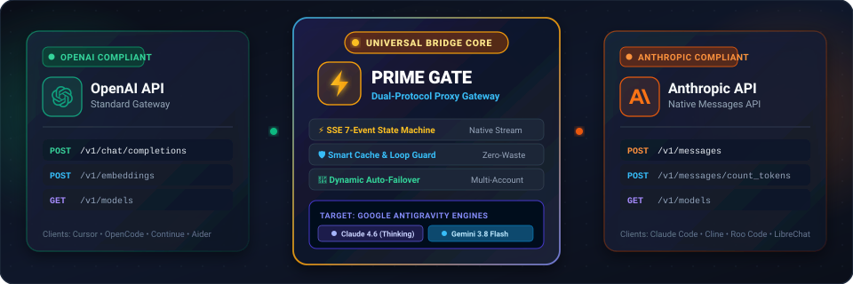

<div align="center">



<br/><br/>

# ⚡ Prime Gate Antigravity Proxy
### `prime-gate-antigravity`

**A Production-Grade, Self-Hosted OpenAI & Anthropic Compatible Proxy Gateway for Google Antigravity.**

[](https://www.npmjs.com/package/prime-gate-antigravity)
[](https://www.npmjs.com/package/prime-gate-antigravity?activeTab=dependencies)
[](https://www.npmjs.com/package/prime-gate-antigravity?activeTab=dependents)
[](LICENSE)
[](https://github.com/irhamkaraman/prime-gate-proxy-antigravity-lik/actions)
[](https://github.com/irhamkaraman/prime-gate-proxy-antigravity-lik)
[](https://python.org)
[](https://nodejs.org)

---

### 🌐 Select Language & Documentation
[🇺🇸 English](README.md) • [🇮🇩 Bahasa Indonesia](locales/id/README.md) • [🇨🇳 简体中文](locales/zh/README.md) • [🇯🇵 日本語](locales/ja/README.md) • [🇷🇺 Русский](locales/ru/README.md) • [🇩🇪 Deutsch](locales/de/README.md) • [🇫🇷 Français](locales/fr/README.md)

📸 [**View Full Dashboard & UI Screenshots Gallery**](docs/SCREENSHOTS.md) • 📚 [**Complete User & Integration Guide**](docs/USER_GUIDE.md)

---

</div>

## 🚀 Quick Install & Run (Windows, macOS, Linux)

Launch Prime Gate instantly on any operating system without manual git cloning or complex environment setup:

```bash
# Option 1: Run instantly with zero installation (via NPX)
npx prime-gate-antigravity

# Option 2: Install globally on your system (Recommended)
npm install -g prime-gate-antigravity@latest

# Start background daemon (Proxy API :52111 + Web UI :52110)
# Works natively on Windows, macOS, and Linux
prime-gate daemon start
```

### 🎛️ CLI Flags & Options
| Flag / Option | Description | Default |
| :--- | :--- | :--- |
| `--host <address>` | Bind host address for proxy server | `127.0.0.1` |
| `--port <number>` | Proxy API port (OpenAI & Anthropic endpoints) | `52111` |
| `--ui-port <number>` | Glassmorphic Web UI dashboard port | `52110` |
| `--daemon` | Start or manage process in background | `false` |
| `--version`, `-v` | Display current installed version | `1.2.10` |
| `--help`, `-h` | Display all available commands and help | - |

---

## ⚠️ Disclaimer & Risks

> [!WARNING]
> **Independent Open-Source Software & Risk Notice:**
> - **Prime Gate Antigravity Proxy** is an independent open-source project and is **NOT affiliated with, endorsed, or approved** by Google LLC or Anthropic PBC.
> - Accessing internal Google Antigravity endpoints outside official extensions may violate service terms.
> - **ACCOUNT SECURITY NOTICE:** **NEVER** use your primary Google account, work email, or sensitive personal accounts. Always use a dedicated secondary experimental Google account. All usage risks rest entirely with the user.

---

## 🤖 Latest Supported Models Catalog

Prime Gate dynamically resolves and translates available upstream Antigravity models into standard OpenAI and Anthropic compatible slugs:

| Model Name | API Slug | Context Window | Reasoning / Thinking | Modality | Best For |
| :--- | :--- | :--- | :--- | :--- | :--- |
| **Claude Sonnet 4.6** | `claude-sonnet-4-6` | 200,000 tokens | ✅ Adaptive CoT | Text + Vision | Agentic coding, Claude Code CLI, Cline, Roo Code |
| **Claude Opus 4.6** | `claude-opus-4-6` | 200,000 tokens | ✅ Deep Reasoning | Text + Vision | Complex architecture, refactoring & planning |
| **Gemini 3.8 Flash** | `gemini-3.8-flash` | 1,000,000 tokens | ✅ Ultra Fast | Multimodal | High-throughput, bulk context, rapid reviews |
| **Claude 3.7 Sonnet** | `claude-3-7-sonnet` | 200,000 tokens | ✅ Hybrid Thinking | Text + Vision | Multi-turn chat & interactive pairing |
| **Claude 3.5 Sonnet** | `claude-3-5-sonnet` | 200,000 tokens | ❌ Standard | Text + Vision | General software engineering & code generation |

---

## ⌨️ Complete Terminal Commands Cheatsheet

All commands can be invoked using `prime-gate <command>` (if globally installed) or `npx prime-gate-antigravity <command>`:

### 1. Service & Daemon Management
```bash
prime-gate daemon start       # Start background daemon (Proxy API + Web UI)
prime-gate daemon status      # Inspect daemon state, PID, memory, and uptime
prime-gate daemon stop        # Stop all background proxy and UI services
prime-gate daemon restart     # Cleanly cycle and restart the background services
prime-gate start              # Run proxy in foreground (interactive terminal mode)
prime-gate ui                 # Launch the Web UI dashboard directly
```

### 2. Google Account Authentication
```bash
prime-gate auth login         # Interactive Google OAuth login (opens browser)
prime-gate auth list          # List all connected Google accounts & status
prime-gate auth switch <mail> # Switch active upstream Google account
prime-gate delete-account --email <mail> # Remove a specific connected account
prime-gate clear-accounts     # Wipe all connected upstream accounts
```

### 3. Client Gateway API Keys & Access Policies
```bash
# Create client API key with rate-limit and daily token policies
prime-gate keys create --name "MyCursorKey" --rpm 60 --tpd 1000000
prime-gate keys list          # View active client keys, limits, and usage
prime-gate keys revoke <id>   # Instantly revoke access for a specific key
```

### 4. Quota, Updates & Database Maintenance
```bash
prime-gate quota              # Display real-time quota balances across all models
prime-gate check-update       # Check npmjs.org registry for new releases
prime-gate db check           # Run CRC32 integrity check & diagnostics
prime-gate db vacuum          # Reclaim storage and defragment SQLite WAL
prime-gate db rollback        # Restore database from previous snapshot
```

---

## 🔌 Quick AI Client Setup

Connect your favorite coding agent to Prime Gate in seconds:

### 1. Claude Code CLI (Native Anthropic Protocol)
```bash
# Set environment variables
export ANTHROPIC_BASE_URL="http://127.0.0.1:52111"
export ANTHROPIC_API_KEY="pg-live-..."  # Generate with: prime-gate keys create

# Launch Claude Code directly
claude --model claude-sonnet-4-6
```

### 2. Cursor IDE / Cline / Roo Code / Continue.dev (OpenAI & Anthropic API)
* **Base URL:** `http://127.0.0.1:52111/v1`
* **API Key:** `pg-live-...` (Generate via `prime-gate keys create` or Web UI)
* **Model ID:** `claude-sonnet-4-6` or `gemini-3.8-flash`

### 3. OpenCode (`~/.config/opencode/opencode.json`)
Connect OpenCode with full tool-calling and thinking support:

**Recommended: Native Anthropic Protocol (Zero OpenAI content guard errors):**
```json
{
  "providers": {
    "antigravity": {
      "type": "anthropic",
      "baseUrl": "http://127.0.0.1:52111",
      "apiKey": "pg-live-your-key",
      "models": ["claude-sonnet-4-6", "claude-opus-4-6-thinking", "gemini-3.8-flash"]
    }
  }
}
```

**Alternative: OpenAI Protocol (Fully compatible with v1.2.10 tool-result & persistent thought-signature normalization):**
```json
{
  "providers": {
    "antigravity": {
      "baseUrl": "http://127.0.0.1:52111/v1",
      "apiKey": "pg-live-your-key",
      "models": ["claude-sonnet-4-6", "gemini-3.8-flash"]
    }
  }
}
```

📖 *For step-by-step guides for Aider, Roo Code, LibreChat, and SDKs, see [Complete User Guide](docs/USER_GUIDE.md#6-ai-client--ide-integration-guide).*

---

## 📸 Web Dashboard Preview

Prime Gate features an Anthropic-inspired dark glassmorphic interface accessible at `http://127.0.0.1:52110`:

* **Live Telemetry & Token Speed** (`/dashboard`)
* **Request Ledger & Latency Benchmarks** (`/benchmarks`)
* **Multi-Account Manager & Quota Status** (`/accounts`)
* **Streaming Prompt Sandbox & Playground** (`/sandbox`)
* **SQLite WAL Database Sentinel & Audit** (`/sentinel`)

👉 **[Explore Full High-Resolution UI Screenshots](docs/SCREENSHOTS.md)**

---

## ❓ Troubleshooting & FAQs

### 1. `503 Service Unavailable: MODEL_CAPACITY_EXHAUSTED`
* **Cause:** Google Antigravity servers are experiencing peak demand for that model.
* **Resolution:** Prime Gate automatically attempts failover to your secondary account. Alternatively, switch active account via `prime-gate auth switch <other-email>` or switch model to `gemini-3.8-flash`.

### 2. `Errno 10048 / Address already in use`
* **Cause:** Another instance of Prime Gate or service is occupying port `52111` or `52110`.
* **Resolution:** Run `prime-gate daemon stop` to terminate background instances, or specify custom ports:
  ```bash
  prime-gate start --port 52120 --ui-port 52121
  ```

### 3. `401 Unauthorized` on AI Client Requests
* **Cause:** Missing or invalid Client Gateway API key.
* **Resolution:** Generate a key with `prime-gate keys create --name "DevKey"`, then pass it in your client's `Authorization: Bearer pg-live-...` header or `x-api-key` header.

### 4. `Command prime-gate not found` (Windows Users)
* **Resolution:** Install globally using `npm install -g prime-gate-antigravity@latest`, or run `scripts\setup-path.ps1` to configure user PATH automatically.

---

## 📜 Version History & Changelog

| Version | Release Date | Key Innovations & Upgrades |
| :--- | :--- | :--- |
| **v1.2.6** | 2026-10-23 | **Modular Documentation & NPM Polish:** Zero-dependency global npm hero install, decoupled UI gallery (`docs/SCREENSHOTS.md`), cp1252 Windows ASCII protection, and unified cheatsheet. |
| **v1.2.5** | 2026-10-23 | **Universal Global NPM Distribution:** Global `prime-gate-antigravity` npm package, bi-directional update notifier, 1-click Windows PATH automator, and automated GitHub Actions release pipeline. |
| **v1.2.4** | 2026-10-23 | **Client Gateway API Key Policy Enforcement:** Granular RPM/TPD rate limiting, lifetime quota budgets, model whitelisting, and cache scope isolation (`cache_scope="key"`). |
| **v1.2.3** | 2026-10-22 | **Autonomous Zero-Touch Auto-Update:** Idle-state auto-updater, anti-ISP DoH web search MCP (`scripts/mcp_search.py`), and Gemini 3 Thought Signature caching. |
| **v1.2.2** | 2026-10-22 | **Next-Gen Semantic Vector Caching:** FastEmbed hybrid vector engine (~12ms latency), 32-bit CRC32 WAL database integrity check, and AES-256-GCM encryption. |
| **v1.2.1** | 2026-10-21 | **Universal Bridge (Native Anthropic Protocol):** Direct drop-in `/v1/messages` endpoint with 7-event SSE streaming state machine for Claude Code & Cline. |
| **v1.1.5** | 2026-10-20 | **Glassmorphic Web UI & Ledger:** React 18 dashboard, WebSocket Sentinel monitoring, request audit ledger, and live telemetry. |

📖 *For comprehensive release notes, see [CHANGELOG.md](CHANGELOG.md) and [GitHub Releases](https://github.com/irhamkaraman/prime-gate-proxy-antigravity-lik/releases).*

---

## 🔍 Known Limitations

1. **Upstream Quota Dependency:** Quota limits, model availability, and rate limits are governed by Google Cloud server-side policies.
2. **Internal API Schema Drift:** Operates against internal Antigravity endpoints; upstream schema modifications may require proxy adapter updates.
3. **Personal Developer Tool:** Engineered for local individual development environments and agent experimentation, not high-volume commercial SaaS resale.

---

## 🛡️ Threat Model

| Boundary / Asset | Protection Mechanism (In-Scope) | Out-of-Scope (Not Protected) |
| :--- | :--- | :--- |
| **Local Credentials** | AES-256-GCM authenticated encryption with OS Keyring integration (Windows DPAPI, macOS Keychain, Linux SecretService) and Scrypt fallback. | Host-level malware or processes running with administrator/root privileges. |
| **Database Integrity** | 32-bit CRC32 per-record checksums prevent silent bit-rot; AES-GCM tags detect tampering. Pre-migration automated backups in `data/backups/`. | Unrecoverable hardware disk destruction. |
| **API Key Authentication** | Salted SHA-256 hash storage. Raw secret keys are displayed only once upon generation and never stored in plain text. | Accidental leaking or public committing of client keys by the user. |
| **Dashboard Security** | Strict loopback host enforcement (`Host` header validation), origin verification, double-submit CSRF tokens, and `HttpOnly` `SameSite=Strict` sessions. | Compromised browser extensions with elevated DOM inspection privileges. |

---

## 🤝 Contributing & License

Contributions, bug reports, and pull requests are warmly welcomed! Please read our [CONTRIBUTING.md](CONTRIBUTING.md) for contribution guidelines and testing practices.

Distributed under the **MIT License**. See [LICENSE](LICENSE) for full details.

Developed with ❤️ by **[irhamkaraman](https://github.com/irhamkaraman)**.
