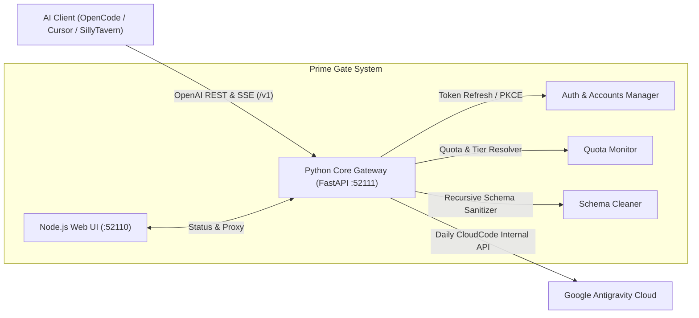

<div align="center">

# ⚡ Prime Gate Antigravity Proxy
### `prime-gate-proxy-antigravity-lik`

**A Production-Grade, Self-Hosted OpenAI-Compatible Proxy Gateway for Google Antigravity.**

[](https://github.com/irhamkaraman/prime-gate-proxy-antigravity-lik)
[](https://python.org)
[](https://nodejs.org)
[](LICENSE)
[](https://github.com/irhamkaraman/prime-gate-proxy-antigravity-lik)

---

### 🌐 Select Language / Pilih Bahasa / 语言选择

[🇺🇸 English](README.md) • [🇮🇩 Bahasa Indonesia](locales/id/README.md) • [🇨🇳 简体中文](locales/zh/README.md) • [🇷🇺 Русский](locales/ru/README.md) • [🇯🇵 日本語](locales/ja/README.md) • [🇩🇪 Deutsch](locales/de/README.md) • [🇫🇷 Français](locales/fr/README.md)

---

</div>

## 📖 Overview

**Prime Gate** is an enterprise-ready, lightweight API bridge that wraps Google's internal Cloud AI Companion / Antigravity service into a **100% OpenAI-compliant REST & SSE API** (`/v1/models`, `/v1/chat/completions`).

It allows you to use your Google Antigravity quotas—including **Claude Sonnet 4.6 (Thinking)**, **Claude Opus 4.6 (Thinking)**, and **Gemini 3.8 Flash**—directly inside any standard AI coding tool, such as **OpenCode**, **Cursor**, **Continue.dev**, **Aider**, **Cline**, and **SillyTavern**.

---

## 🌟 Key Architecture & Highlights



### 🎯 Core Capabilities:
1. **100% OpenAI Specification Compliant:**
   Seamless drop-in replacement for standard OpenAI client configurations.
2. **Real-time Reasoning / Thinking Stream:**
   Natively streams deep thinking blocks via `choices[0].delta.reasoning_content` for Claude 4.6 Thinking and Gemini 3.8.
3. **Zero 400 Bad Request (Recursive Schema Sanitizer):**
   Eliminates Google Antigravity's strict schema errors (`exclusiveMinimum`, `exclusiveMaximum`, `$schema`, `additionalProperties`) for 100% stable Tool Calling & Function Execution.
4. **Intelligent Quota & Tier Detection:**
   Distinguishes between **`Google AI Pro (Trial Tier)`** and **`Google AI Pro (Paid Tier)`**, automatically presenting only valid model catalogs.
5. **Interactive Glassmorphic Web UI:**
   Built-in zero-dependency Node.js frontend dashboard at `http://127.0.0.1:52110` with live quota radar bars, server uptime, and an interactive prompt testing sandbox.
6. **Rich Terminal CLI Suite:**
   Modern terminal interface featuring `--version`, `quota`, `auth list|import|login`, and headless Windows background `daemon` management.

---

## ⚡ Quick Start

### 1. Clone & Install
```bash
git clone https://github.com/irhamkaraman/prime-gate-proxy-antigravity-lik.git
cd prime-gate-proxy-antigravity-lik
pip install -r requirements.txt
```
*(Windows users can simply double-click `scripts\install.bat`)*

### 2. Connect Your Google Antigravity Account
- **Option A: Auto-import from existing OpenCode config:**
  ```bash
  python -m prime_gate.cli auth import
  ```
- **Option B: Authenticate a new Google Account via browser:**
  ```bash
  python -m prime_gate.cli auth login
  ```

### 3. Check Live Quota
```bash
python -m prime_gate.cli quota
```

### 4. Start Server & Dashboard
- **One-click background launcher (Windows):**
  ```bash
  scripts\start-all.bat
  ```
- **Or start foreground API server:**
  ```bash
  python -m prime_gate.cli start --port 52111
  ```
- **Launch Web UI:**
  ```bash
  python -m prime_gate.cli ui --port 52110
  ```
  *Open your browser at `http://127.0.0.1:52110`.*

---

## 💻 CLI Command Reference

Execute commands using `python -m prime_gate.cli` or `bin\prime-gate.cmd`:

| Command | Description |
| :--- | :--- |
| `prime-gate --version` | Display version, runtime info, and codename. |
| `prime-gate --help` | Show complete interactive command list. |
| `prime-gate quota` | Display real-time quota status table & active model catalog. |
| `prime-gate auth list` | Show all stored Google Antigravity accounts. |
| `prime-gate auth import` | Import accounts from `~/.config/opencode/antigravity-accounts.json`. |
| `prime-gate auth login` | Open browser for Google OAuth 2.0 PKCE authentication. |
| `prime-gate daemon start` | Launch proxy & web UI in the background (headless). |
| `prime-gate daemon status` | Check background process PID, memory, and ports. |
| `prime-gate daemon stop` | Terminate all active background proxy services. |
| `prime-gate start` | Run API server in foreground with live request logs. |
| `prime-gate ui` | Start and open the Node.js Web UI Dashboard. |

---

## 🔌 AI Client Configuration Examples

### OpenCode (`~/.config/opencode/opencode.json`)
```json
{
  "providers": {
    "antigravity": {
      "baseUrl": "http://127.0.0.1:52111/v1",
      "apiKey": "prime-gate-proxy",
      "models": [
        "claude-sonnet-4-6",
        "claude-opus-4-6-thinking",
        "gemini-3.8-flash",
        "gemini-2.5-pro"
      ]
    }
  }
}
```

### Cursor / Continue.dev / SillyTavern
- **API Base URL:** `http://127.0.0.1:52111/v1`
- **API Key:** `prime-gate-proxy` (any non-empty string)
- **Model Name:** `claude-sonnet-4-6` or `gemini-3.8-flash`

---

## 📊 Subscription Tier Catalog

| Model Name | Google AI Pro (Trial Tier) | Google AI Pro (Paid Tier) |
| :--- | :---: | :---: |
| **Claude Sonnet 4.6 (Thinking)** | ✅ Available | ❌ Replaced by 5.5 |
| **Claude Opus 4.6 (Thinking)** | ✅ Available | ❌ Replaced by 5.5 |
| **Gemini 3.8 Flash (Fast)** | ✅ Available | ✅ Available |
| **Gemini 2.5 Pro / Flash** | ✅ Available | ✅ Available |
| **GPT-OSS 120B (Medium)** | ✅ Available | ✅ Available |
| **Claude Sonnet 5.5 (Thinking)** | ❌ Paid Exclusive | ✅ Available |
| **Gemini 4 Argon (Low)** | ❌ Paid Exclusive | ✅ Available |

---

## 📁 Repository Structure

```text
prime-gate-proxy-antigravity-lik/
├── bin/                       # Windows CMD & Node.js CLI launchers
├── locales/                   # Multi-language documentation (ID, ZH, RU, JA, DE, FR)
├── prime_gate/                # Python Core Engine Package
│   ├── auth/                  # OAuth & Multi-Account Managers
│   ├── daemon/                # Windows Headless Background Service
│   ├── quota/                 # Dynamic Quota & Subscription Tier Resolver
│   ├── translator/            # OpenAI <-> Antigravity Converters & Schema Cleaner
│   ├── cli.py                 # Rich Terminal CLI Interface
│   ├── config.py              # Ports, Credentials & Runtime Settings
│   └── server.py              # FastAPI OpenAI-Compatible Endpoints
├── scripts/                   # One-Click Windows Batches (install, start, stop)
├── ui/                        # Node.js Web UI Dashboard
│   ├── public/                # Glassmorphic Static Assets (HTML/CSS/JS)
│   └── server.js              # Ultra-lightweight Native HTTP Proxy Server
├── package.json               # Node.js Project Metadata
├── pyproject.toml             # Python PEP 517/621 Metadata
├── requirements.txt           # Python Dependencies
├── README.md                  # Main English Documentation
└── LICENSE                    # MIT License
```

---

## 🤝 Contributing

Contributions, bug reports, and feature pull requests are warmly welcome!
1. Fork this repository.
2. Create your feature branch (`git checkout -b feature/amazing-feature`).
3. Commit your changes (`git commit -m 'feat: add amazing feature'`).
4. Push to the branch (`git push origin feature/amazing-feature`).
5. Open a Pull Request.

---

## 📜 License & Author

- **Author:** [Irham Karaman](https://github.com/irhamkaraman)
- **License:** Distributed under the [MIT License](LICENSE).

<div align="center">
<b>Built with ❤️ for the Global AI & Open-Source Developer Community.</b>
</div>
