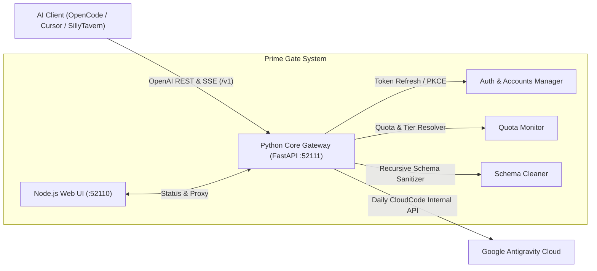

<div align="center">

# ⚡ Prime Gate Antigravity Proxy
### `prime-gate-proxy-antigravity-lik`

**A Production-Grade, Self-Hosted OpenAI-Compatible Proxy Gateway for Google Antigravity.**

[](https://github.com/irhamkaraman/prime-gate-proxy-antigravity-lik)
[](https://python.org)
[](https://nodejs.org)
[](LICENSE)
[](https://github.com/irhamkaraman/prime-gate-proxy-antigravity-lik)

---

### 🌐 Select Language / Pilih Bahasa / 语言选择

[🇺🇸 English](README.md) • [🇮🇩 Bahasa Indonesia](locales/id/README.md) • [🇨🇳 简体中文](locales/zh/README.md) • [🇷🇺 Русский](locales/ru/README.md) • [🇯🇵 日本語](locales/ja/README.md) • [🇩🇪 Deutsch](locales/de/README.md) • [🇫🇷 Français](locales/fr/README.md) • [📖 Full User Guide](docs/USER_GUIDE.md)

---

</div>

## 📖 Overview

**Prime Gate** is an enterprise-ready, lightweight API bridge that wraps Google's internal Cloud AI Companion / Antigravity service into a **100% OpenAI-compliant REST & SSE API** (`/v1/models`, `/v1/chat/completions`).

It allows you to use your Google Antigravity quotas—including **Claude Sonnet 4.6 (Thinking)**, **Claude Opus 4.6 (Thinking)**, and **Gemini 3.8 Flash**—directly inside any standard AI coding tool, such as **OpenCode**, **Cursor**, **Continue.dev**, **Aider**, **Cline**, and **SillyTavern**.

---

## 🌟 Key Architecture & Highlights



### 🎯 Core Capabilities:
1. **100% OpenAI Specification Compliant:**
   Seamless drop-in replacement for standard OpenAI client configurations.
2. **Real-time Reasoning / Thinking Stream:**
   Natively streams deep thinking blocks via `choices[0].delta.reasoning_content` for Claude 4.6 Thinking and Gemini 3.8.
3. **Zero 400 Bad Request (Recursive Schema Sanitizer):**
   Eliminates Google Antigravity's strict schema errors (`exclusiveMinimum`, `exclusiveMaximum`, `$schema`, `additionalProperties`) for 100% stable Tool Calling & Function Execution.
4. **Intelligent Quota & Tier Detection:**
   Distinguishes between **`Google AI Pro (Trial Tier)`** and **`Google AI Pro (Paid Tier)`**, automatically presenting only valid model catalogs.
5. **Modern Tailwind CSS v4 Dashboard with Sidebar & Token Bar Chart:**
   Self-contained offline dashboard with clean sidebar navigation, real-time token telemetry (per-second, per-minute, per-hour, per-day stacked bar charts with Chart.js), dedicated Account Manager with live quota meters, interactive Prompt Sandbox, and Database Sentinel diagnostics.
6. **Rich Terminal CLI Suite:**
   Modern terminal interface featuring `--version`, `quota`, `auth list|import|login|remove|clear`, `db status|check|test-corrupt`, and headless Windows background `daemon` management.
7. **Compiled C Binary Database (Zero Plaintext JSON):**
   Replaces human-readable JSON storage with a high-performance compiled C binary engine (SQLite WAL + Sealed BLOBs). Sensitive tokens, credentials, models, and quotas are binary-masked with strict 32-bit CRC32 checksum validation.
8. **Real-Time WebSocket & Database Sentinel Watchdog:**
   Pipes live server logs and database mutations directly to dashboard over bidirectional WebSocket (`/ws/live`). An autonomous Sentinel Watchdog continuously audits binary block integrity and fires instant critical alerts and telemetry upon any corruption detection.

---

## ⚡ Quick Start

### 1. Clone & Install
```bash
git clone https://github.com/irhamkaraman/prime-gate-proxy-antigravity-lik.git
cd prime-gate-proxy-antigravity-lik
pip install -r requirements.txt
```
*(Windows users can simply double-click `scripts\install.bat`)*

### 2. Launch Background Daemon & Web UI
Start both the Python Core API and Node.js Web UI with a single command:
- **Windows (One-Click Background Launcher):**
  ```bash
  scripts\start-all.bat
  ```
- **Or via CLI Daemon:**
  ```bash
  python -m prime_gate.cli daemon start
  ```
- **Or Foreground Terminal Mode:**
  ```bash
  # Terminal 1: Core API
  python -m prime_gate.cli start --port 52111

  # Terminal 2: Web UI
  python -m prime_gate.cli ui --port 52110
  ```

### 3. Open Web UI Onboarding & Connect Account
1. Open your browser and navigate to **`http://127.0.0.1:52110`**.
2. If you haven't logged in yet, the **Anthropic-styled Setup Onboarding** overlay will appear automatically:
   - Click **"Sign in with Google"** to authenticate via Google OAuth 2.0 PKCE.
   - Or click **"⚡ Quick Import from OpenCode Config"** if you already have accounts saved in OpenCode.
3. Once authenticated, Prime Gate automatically transitions into the main **System Dashboard**, activating your live Quota Radar, active model catalog, and OpenAI endpoint (`http://127.0.0.1:52111/v1`).

> 💡 **CLI Alternative:** Prefer CLI setup? You can also authenticate directly in terminal:
> ```bash
> python -m prime_gate.cli auth login   # Sign in via browser OAuth
> python -m prime_gate.cli auth import  # Import OpenCode config
> python -m prime_gate.cli quota        # View live quota table
> ```

---

## 💻 CLI Command Reference

Execute commands using `python -m prime_gate.cli` or `bin\prime-gate.cmd`:

| Command | Description |
| :--- | :--- |
| `prime-gate --version` | Display version, runtime info, and codename. |
| `prime-gate --help` | Show complete interactive command list. |
| `prime-gate quota` | Display real-time quota status table & active model catalog. |
| `prime-gate check-models` | Auto-load live supported models directly from Google Antigravity servers. |
| `prime-gate auth list` | Show all stored Google Antigravity accounts. |
| `prime-gate auth import` | Import accounts from `~/.config/opencode/antigravity-accounts.json`. |
| `prime-gate auth login` | Open browser for Google OAuth 2.0 PKCE authentication. |
| `prime-gate auth remove [EMAIL]` | Remove account (or pick interactively from a numbered menu). |
| `prime-gate auth remove -e <email> -f` | Delete account via flag with forced confirmation bypass (`--email`, `--force`). |
| `prime-gate auth remove -a -f` | Delete ALL accounts via flags without prompt (`--all`, `--force`). |
| `prime-gate delete-account [email]` | Direct top-level shortcut to delete account or all accounts. |
| `prime-gate auth clear -y` | Remove all stored accounts and reset to initial onboarding state. |
| `prime-gate daemon start` | Launch proxy & web UI in the background (headless). |
| `prime-gate daemon status` | Check background process PID, memory, and ports. |
| `prime-gate daemon stop` | Terminate all active background proxy services. |
| `prime-gate db check` | Run 32-bit CRC32 cryptographic audit on binary database. |
| `prime-gate start` | Run API server in foreground with live request logs. |
| `prime-gate ui` | Start and open the Node.js Web UI Dashboard. |

### 🗑️ Account Deletion & Management Flags:
Prime Gate provides flexible flags to remove individual or all accounts from both terminal and Web UI:
- **Delete specific account via flag:**
  ```bash
  python -m prime_gate.cli auth remove --email user@gmail.com --force
  # Or via shortcut:
  python -m prime_gate.cli delete-account -e user@gmail.com -f
  ```
- **Delete ALL accounts without prompt:**
  ```bash
  python -m prime_gate.cli auth remove --all --force
  ```
- **Interactive selection:**
  Run `python -m prime_gate.cli auth remove` without arguments to select from a numbered list of registered accounts.
- **In Web UI:**
  Navigate to the **Account Manager** tab, click the red **"Delete"** button on any account card or **"Delete Account"** on the Active Identity card. Click **"Clear All"** to wipe all accounts.

---

## 🔌 AI Client Integration & Setup Guide

Prime Gate provides a 100% OpenAI-compliant gateway at **`http://127.0.0.1:52111/v1`**. Use API Key `prime-gate-proxy` (or any non-empty string).

### 1. Cursor IDE
1. Open Cursor Settings (**Ctrl+,** or **Cmd+,**).
2. Go to **Features** &gt; **Models**.
3. Under **OpenAI API Key**, enter: `prime-gate-proxy`.
4. Toggle on **Override OpenAI Base URL** and enter:
   ```text
   http://127.0.0.1:52111/v1
   ```
5. In **Add Model**, add your desired models:
   - `claude-sonnet-4-6` (Thinking enabled)
   - `gemini-3.8-flash` (Recommended daily driver)
   - `claude-opus-4-6-thinking`

---

### 2. OpenCode (`~/.config/opencode/opencode.json`)
Add or merge the `antigravity` provider in your OpenCode configuration:
```json
{
  "providers": {
    "antigravity": {
      "baseUrl": "http://127.0.0.1:52111/v1",
      "apiKey": "prime-gate-proxy",
      "models": [
        "claude-sonnet-4-6",
        "claude-opus-4-6-thinking",
        "gemini-3.8-flash",
        "gemini-3.8-flash-high",
        "gemini-3.1-flash-lite",
        "gpt-oss-120b-medium"
      ]
    }
  }
}
```

---

### 3. Continue.dev (`~/.continue/config.json`)
Add Prime Gate into your `models` list:
```json
{
  "models": [
    {
      "title": "Claude Sonnet 4.6 (Prime Gate)",
      "provider": "openai",
      "model": "claude-sonnet-4-6",
      "apiBase": "http://127.0.0.1:52111/v1",
      "apiKey": "prime-gate-proxy"
    },
    {
      "title": "Gemini 3.8 Flash (Prime Gate)",
      "provider": "openai",
      "model": "gemini-3.8-flash",
      "apiBase": "http://127.0.0.1:52111/v1",
      "apiKey": "prime-gate-proxy"
    }
  ]
}
```

---

### 4. Cline / Roo Code (VS Code Extension)
1. Open Cline Settings.
2. Select API Provider: **OpenAI Compatible**.
3. Set **Base URL**: `http://127.0.0.1:52111/v1`.
4. Set **API Key**: `prime-gate-proxy`.
5. Set **Model ID**: `claude-sonnet-4-6` or `gemini-3.8-flash`.

---

### 5. Aider (Terminal AI Pair Programmer)
Launch Aider pointing to the Prime Gate proxy endpoint:
```bash
aider --openai-api-base http://127.0.0.1:52111/v1 \
      --openai-api-key prime-gate-proxy \
      --model openai/claude-sonnet-4-6
```

---

### 6. Python OpenAI SDK
```python
from openai import OpenAI

client = OpenAI(
    base_url="http://127.0.0.1:52111/v1",
    api_key="prime-gate-proxy"
)

# Streaming with reasoning / thinking
response = client.chat.completions.create(
    model="claude-sonnet-4-6",
    messages=[
        {"role": "user", "content": "Write an optimized LRU cache with threading lock."}
    ],
    stream=True
)

for chunk in response:
    delta = chunk.choices[0].delta
    # Thinking stream
    if hasattr(delta, "reasoning_content") and delta.reasoning_content:
        print(f"[THINKING] {delta.reasoning_content}", end="", flush=True)
    # Output content stream
    if delta.content:
        print(delta.content, end="", flush=True)
```

---

### 7. Node.js / TypeScript SDK
```typescript
import OpenAI from "openai";

const client = new OpenAI({
  baseURL: "http://127.0.0.1:52111/v1",
  apiKey: "prime-gate-proxy",
});

async function main() {
  const completion = await client.chat.completions.create({
    model: "gemini-3.8-flash",
    messages: [{ role: "user", content: "Explain SQLite WAL mode in 3 sentences." }],
  });

  console.log(completion.choices[0].message.content);
}

main();
```

---

### 8. cURL / REST API Test
```bash
curl -X POST http://127.0.0.1:52111/v1/chat/completions \
  -H "Content-Type: application/json" \
  -H "Authorization: Bearer prime-gate-proxy" \
  -d '{
    "model": "claude-sonnet-4-6",
    "messages": [{"role": "user", "content": "Hello Prime Gate!"}],
    "stream": false
  }'
```

---

### 9. Health & Observability API (`/v1/health`)
Query gateway status, operational health for all models, quota buckets, and recent structured logs:
```bash
# Basic health check
curl http://127.0.0.1:52111/v1/health

# Health check with last 20 logs filtered by ERROR level
curl "http://127.0.0.1:52111/v1/health?limit=20&level=ERROR"

# Health check with force live refresh from upstream Antigravity
curl "http://127.0.0.1:52111/v1/health?refresh=true"
```

---

## 🧠 Real-Time Reasoning & Thinking Stream

For models with extended thinking capabilities (**Claude Sonnet 4.6**, **Claude Opus 4.6**, and **Gemini 3.8 Flash**), Prime Gate parses Google Antigravity's internal reasoning events and streams them via standard OpenAI delta chunks:

```json
{
  "choices": [
    {
      "index": 0,
      "delta": {
        "reasoning_content": "Deconstructing problem into fundamental constraints..."
      }
    }
  ]
}
```

- **In Web UI Sandbox:** Thinking blocks are rendered within glowing `[THINKING] ... [/THINKING]` badges before the final response stream.
- **In Compatible IDEs (Cursor/OpenCode):** Thinking thoughts appear natively in collapsible thought boxes.

---

## 🛡️ Compiled Binary Database & Sentinel Watchdog

Unlike traditional proxies that store OAuth tokens and credentials in unencrypted `accounts.json` files, Prime Gate uses a **compiled C binary storage engine** (`data/prime_gate.pgdb`):

- **Zero Plaintext JSON:** Sensitive tokens and quotas are sealed in binary BLOB records (`REC_ACCOUNT`, `REC_MODEL`, `REC_QUOTA`).
- **32-Bit CRC32 Integrity Checksums:** Every binary block is protected against tampering. If a file corruption occurs, the Sentinel Watchdog detects it within 5 seconds.
- **SQLite WAL Mode:** Supports ultra-low latency, concurrent reads and writes without file-locking bottlenecks.
- **WebSocket Event Bus (`/ws/live`):** Live database mutations and error logs are broadcast in real-time to the Web UI dashboard terminal.

---

## 📊 Subscription Tier Catalog & Quota

Prime Gate queries Google's internal APIs dynamically to detect your account's exact tier:

| Model Name | Google AI Pro (Trial Tier) | Google AI Pro (Paid Tier) | Thinking Support |
| :--- | :---: | :---: | :---: |
| **Claude Sonnet 4.6 (Thinking)** | ✅ Available | ❌ Replaced by 5.5 | ✓ Up to 64k tokens |
| **Claude Opus 4.6 (Thinking)** | ✅ Available | ❌ Replaced by 5.5 | ✓ Deep reasoning |
| **Gemini 3.8 Flash (Recommended)** | ✅ Available | ✅ Available | ✓ Fast thinking |
| **Gemini 3.8 Flash High / Med / Low** | ✅ Available | ✅ Available | ✓ Configurable budget |
| **Gemini 3.1 Flash Lite** | ✅ Available | ✅ Available | Standard |
| **GPT-OSS 120B (Medium)** | ✅ Available | ✅ Available | Standard |
| **Claude Sonnet 5.5 (Thinking)** | ❌ Paid Exclusive | ✅ Available | ✓ Extended thinking |
| **Gemini 4 Argon (Low)** | ❌ Paid Exclusive | ✅ Available | Standard |

> ⚠️ **Notice on Gemini 2.5:** `gemini-2.5-pro` and `gemini-2.5-flash` were removed from the active catalog due to Google upstream 503 capacity exhaustion (`MODEL_CAPACITY_EXHAUSTED`). Please use **`gemini-3.8-flash`** or **`claude-sonnet-4-6`**.

---

## ❓ FAQ & Troubleshooting

### 1. "503 Service Unavailable: MODEL_CAPACITY_EXHAUSTED"
- **Cause:** Requesting older or heavily congested models like Gemini 2.5.
- **Fix:** Use `gemini-3.8-flash` or `claude-sonnet-4-6`.

### 2. "Errno 10048: Only one usage of each socket address is normally permitted"
- **Cause:** Port 52111 or 52110 is already being used by an existing background process.
- **Fix:** Stop existing daemons via `prime-gate daemon stop`, or pass a custom port: `prime-gate start --port 52120`.

### 3. "Where are credentials saved?"
- **Answer:** In `data/prime_gate.pgdb` (compiled binary database). It is automatically ignored by Git, ensuring **zero credentials or tokens are committed**.

---

## 📁 Repository Structure

```text
prime-gate-proxy-antigravity-lik/
├── bin/                       # Windows CMD & Node.js CLI launchers
├── locales/                   # Multi-language documentation (ID, ZH, RU, JA, DE, FR)
├── prime_gate/                # Python Core Engine Package
│   ├── auth/                  # OAuth & Multi-Account Managers
│   ├── daemon/                # Windows Headless Background Service
│   ├── quota/                 # Dynamic Quota & Subscription Tier Resolver
│   ├── translator/            # OpenAI <-> Antigravity Converters & Schema Cleaner
│   ├── cli.py                 # Rich Terminal CLI Interface
│   ├── config.py              # Ports, Credentials & Runtime Settings
│   └── server.py              # FastAPI OpenAI-Compatible Endpoints
├── scripts/                   # One-Click Windows Batches (install, start, stop)
├── ui/                        # Node.js Web UI Dashboard
│   ├── public/                # Glassmorphic Static Assets (HTML/CSS/JS)
│   └── server.js              # Ultra-lightweight Native HTTP Proxy Server
├── package.json               # Node.js Project Metadata
├── pyproject.toml             # Python PEP 517/621 Metadata
├── requirements.txt           # Python Dependencies
├── README.md                  # Main English Documentation
└── LICENSE                    # MIT License
```

---

## 🤝 Contributing

Contributions, bug reports, and feature pull requests are warmly welcome!
1. Fork this repository.
2. Create your feature branch (`git checkout -b feature/amazing-feature`).
3. Commit your changes (`git commit -m 'feat: add amazing feature'`).
4. Push to the branch (`git push origin feature/amazing-feature`).
5. Open a Pull Request.

---

## 📜 License & Author

- **Author:** [Irham Karaman](https://github.com/irhamkaraman)
- **License:** Distributed under the [MIT License](LICENSE).

<div align="center">
<b>Built with ❤️ for the Global AI & Open-Source Developer Community.</b>
</div>
