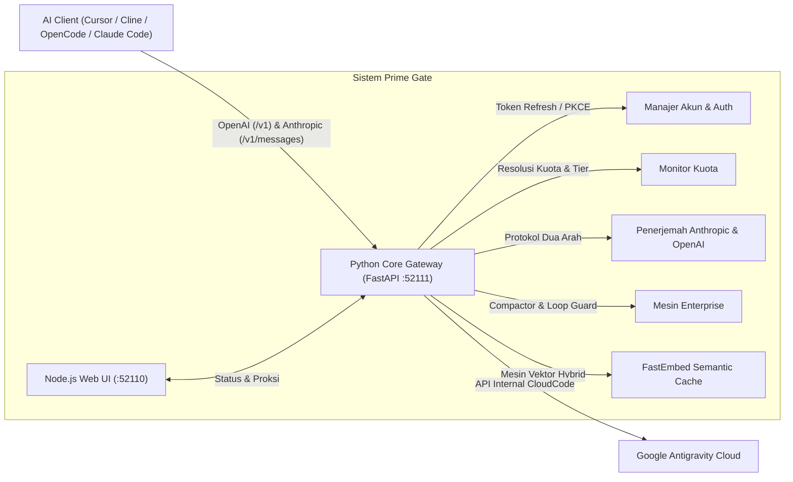
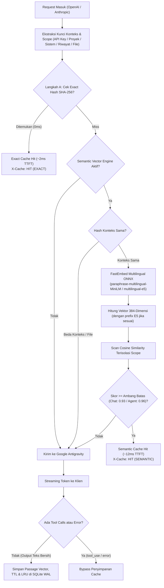

<div align="center">


<br/><br/>

# ⚡ Prime Gate Antigravity Proxy
### `prime-gate-proxy-antigravity-lik`

**Gateway Proksi Mandiri (Self-Hosted) Tingkat Perusahaan Kompatibel OpenAI & Anthropic untuk Google Antigravity.**

[](https://github.com/irhamkaraman/prime-gate-proxy-antigravity-lik)
[](../../.github/workflows/ci.yml)
[](#-keamanan-permintaan--penyelarasan-klien-request-safety--client-alignment)
[](#-next-gen-smart--semantic-vector-caching-hybrid-engine)
[](https://python.org)
[](https://nodejs.org)
[](../../LICENSE)
[](https://github.com/irhamkaraman/prime-gate-proxy-antigravity-lik)

---

### 🌐 Pilih Bahasa & Dokumentasi

[🇺🇸 English](../../README.md) • [🇮🇩 Bahasa Indonesia](README.md) • [🇨🇳 简体中文](../zh/README.md) • [🇷🇺 Русский](../ru/README.md) • [🇯🇵 日本語](../ja/README.md) • [🇩🇪 Deutsch](../de/README.md) • [🇫🇷 Français](../fr/README.md)

📚 **Panduan:** [Panduan Pengguna](../../docs/USER_GUIDE.md) • [Pengujian & Konformansi](../../docs/testing.md) • [Observabilitas & Metrik](../../docs/observability.md) • [Metodologi Benchmark](../../benchmarks/METHODOLOGY.md)

---

</div>

## ⚠️ Disclaimer & Risiko (Ketentuan & Batasan Tanggung Jawab)

> [!WARNING]
> **Proyek Tidak Resmi & Penggunaan Atas Risiko Sendiri:**
> - **Prime Gate Antigravity Proxy** adalah proyek open-source independen dan **TIDAK berafiliasi, didukung, atau disetujui** oleh Google LLC maupun Anthropic PBC.
> - Penggunaan proxy ini untuk mengakses layanan internal Google Cloud AI Companion / Antigravity di luar ekstensi resmi VS Code **dapat berpotensi melanggar Ketentuan Layanan (Terms of Service)** Google Cloud.
> - Seluruh risiko penggunaan berada pada pengguna sepenuhnya. Pengembang/maintainer tidak bertanggung jawab atas segala konsekuensi, termasuk pembatasan kuota, penangguhan, atau penutupan akun Google yang digunakan.
> - **PERINGATAN KEAMANAN AKUN:** **JANGAN PERNAH** menggunakan akun Google utama, akun email pribadi penting, atau akun pekerjaan/organisasi Anda. Sangat disarankan hanya menggunakan akun Google sekunder atau akun khusus untuk eksperimen.

---

## 📖 Ringkasan Proyek

**Prime Gate** adalah jembatan API enterprise dual-protokol yang membungkus layanan internal Google Cloud AI Companion / Antigravity menjadi endpoint REST & SSE yang **patuh pada standar OpenAI** (`/v1/chat/completions`) dan **protokol asli Anthropic Messages API** (`/v1/messages`).

Alat ini memungkinkan Anda memanfaatkan kuota Google Antigravity Anda—termasuk **Claude Sonnet 4.6 (Thinking)**, **Claude Opus 4.6 (Thinking)**, dan **Gemini 3.8 Flash**—secara langsung di dalam berbagai alat AI coding modern seperti **Claude Code CLI**, **Cline**, **Roo Code**, **OpenCode**, **Cursor**, **Continue.dev**, **Aider**, dan **SillyTavern**.

---

## 🔍 Batasan yang Diketahui (Known Limitations)

1. **Ketergantungan Kuota Upstream:** Kuota inferensi, ketersediaan model, dan batas frekuensi request (*rate limits*) sepenuhnya diatur oleh kebijakan server Google Cloud.
2. **Perubahan Skema API Internal:** Karena beroperasi di atas API internal Google Antigravity, perubahan skema mendadak dari upstream dapat memengaruhi fungsi translasi hingga update adaptasi dirilis.
3. **Pencarian Web Publik:** MCP Web Search (`scripts/mcp_search.py`) mengandalkan resolver publik DoH (Cloudflare 1.1.1.1) dan parser DuckDuckGo yang dapat mengalami perubahan format sewaktu-waktu.
4. **Bukan Pengganti Layanan API Komersial Resmi:** Proyek ini ditujukan untuk kebutuhan alur kerja developer personal dan eksperimen lokal, bukan untuk beban produksi komersial berskala besar.

---

## 🛡️ Model Ancaman (Threat Model)

Untuk menjaga transparansi teknis, tabel berikut mendefinisikan apa yang dilindungi (*in-scope*) dan apa yang berada di luar kendali sistem (*out-of-scope*):

| Area / Komponen | Apa yang Dilindungi (In-Scope) | Apa yang TIDAK Dilindungi (Out-of-Scope) |
| :--- | :--- | :--- |
| **Kredensial & Token Lokal** | Enkripsi terotentikasi AES-256-GCM dengan nonce 12-byte acak unik per record dan AAD binding. Kunci enkripsi diisolasi dalam OS Keyring (Windows DPAPI, macOS Keychain, Linux SecretService) dengan fallback terderivasi Scrypt KDF. Token otomatis diabaikan dari git tracking. | Perlindungan terhadap malware atau proses dengan hak akses root/administrator pada sistem operasi lokal Anda. |
| **Integritas Database** | Checksum 32-bit CRC32 mendeteksi kerusakan fisik bit (*bit-rot* / disk corruption), sementara Authentication Tag AES-256-GCM mendeteksi modifikasi atau manipulasi data yang disengaja. Backup otomatis dibuat di `data/backups/`. | Kerusakan fisik media penyimpanan yang tidak dapat dipulihkan (*hardware failure*). Perintah `prime-gate db rollback` disediakan untuk pemulihan dari backup lokal. |
| **Autentikasi & Batas Akses** | Seluruh endpoint proxy (`/v1/*`) mewajibkan API Key (`Authorization: Bearer` atau `x-api-key`). Kunci disimpan hanya dalam bentuk hash salted SHA-256. Non-loopback host binding dilindungi dari risiko paparan tanpa autentikasi. | Pembagian kunci API yang tidak disengaja oleh pengguna ke pihak luar. |
| **Perlindungan Dashboard & Localhost** | Mitigasi DNS Rebinding (validasi header `Host`), validasi `Origin`, double-submit CSRF token, sesi `HttpOnly` `SameSite=Strict`, dan security headers (CSP, nosniff, DENY, Referrer-Policy). Handshake WebSocket `/sentinel` memvalidasi sesi dan origin. | Ekstensi browser pihak ketiga yang memiliki izin istimewa untuk membaca cookie atau memodifikasi DOM secara lokal. |
| **Pola Lalu Lintas Klien** | Normalisasi header HTTP/gRPC menyerupai format IDE resmi, humanized pacing, dan Sentinel Loop Guard (memutus loop tool $\ge 3$ kali). | Analisis pola trafik sisi server Google (pemeriksaan IP, audit perilaku, dsb). **Tidak ada jaminan kebal deteksi atau anti-ban.** |
| **Konsumsi Kuota** | Cache vektor semantik lokal (~12ms) mengurangi panggilan duplikat ke upstream. | Penyesuaian kuota, batas harian, atau kebijakan langganan oleh pihak Google. |

---

## 🌟 Arsitektur & Sorotan Fitur Utama



### 🎯 Kapabilitas Inti:
1. **Dukungan Protokol Ganda (OpenAI & Anthropic Asli):**
   Mendukung penuh OpenAI (`/v1/chat/completions`) dan Anthropic Messages API (`/v1/messages`, `/v1/messages/count_tokens`) tanpa perlu adapter pihak ketiga.
2. **Koneksi Langsung Claude Code CLI & Cline:**
   Menghubungkan langsung **Claude Code CLI, Cline, Roo Code, Cursor (mode Claude), Continue.dev, dan LibreChat** langsung ke Prime Gate.
3. **State Machine Streaming 7-Event Anthropic:**
   Implementasi SSE streaming Anthropic yang ketat: `message_start`, `content_block_start`, `content_block_delta` (`text_delta` & `input_json_delta`), `content_block_stop`, `message_delta`, dan `message_stop`.
4. **Endpoint Pra-Hitung Token (`POST /v1/messages/count_tokens`):**
   Memungkinkan coding agent otonom (Cline, Roo Code, Claude Code) menghitung anggaran context window secara presisi sebelum melakukan inferensi.
5. **Streaming Penalaran Real-Time (Thinking / Reasoning Stream):**
   Secara native mengalirkan blok penalaran mendalam via `choices[0].delta.reasoning_content` untuk Claude 4.6 Thinking dan Gemini 3.8.
6. **Bebas Error 400 Bad Request (Sanitizer Skema Rekursif):**
   Membersihkan atribut skema yang tidak didukung Google Antigravity (`exclusiveMinimum`, `exclusiveMaximum`, `$schema`, `additionalProperties`) agar pemanggilan tool (Tool Calling) 100% stabil.
7. **Deteksi Cerdas Kuota & Tingkatan Langganan:**
   Membedakan akun **`Google AI Pro (Trial Tier)`** dan **`Google AI Pro (Paid Tier)`** secara otomatis, hanya menyajikan katalog model yang valid.
8. **Dasbor Modern React & TypeScript SPA dengan Rute Mandiri:**
   Dibangun dengan Vite dan TypeScript ketat, rute navigasi khusus (`/dashboard`, `/accounts`, `/sandbox`, `/caching`, `/sentinel`, `/docs`), telemetri throughput token real-time, sandbox interaktif dengan saklar OpenAI/Anthropic, dan diagnostik Database Sentinel.
9. **Suite CLI Terminal Interaktif:**
   Perintah terminal lengkap meliputi `--version`, `quota`, `auth list|import|login|remove|clear`, `db status|check|test-corrupt`, dan daemon Windows background.
10. **Database SQLite WAL dengan Obfuscation Record & Integritas CRC32:**
    Menggantikan file JSON biasa dengan mesin biner SQLite WAL berperforma tinggi. Kredensial dan token terlindungi dengan verifikasi checksum CRC32 32-bit.
11. **Smart Agent Context Compactor:**
    Memangkas riwayat output tool yang panjang di luar 3 turn aktif terakhir sambil mempertahankan instruksi sistem dan turn awal, menghemat 50% hingga 70% token prompt agent coding.
12. **Failover Akun Otomatis Mid-Flight:**
    Mencegah error HTTP 429 (`RESOURCE_EXHAUSTED`) / 503 dari server Google dan merotasi akun ke akun cadangan terbaik sebelum chunk token pertama dikirim ke pengguna—tanpa memutus koneksi client.
13. **Sentinel Pembasmi Loop Otonom (Runaway Loop Killer):**
    Mendeteksi pemanggilan tool berulang tanpa kemajuan ($\ge 3$ kali berturut-turut) dan menyuntikkan instruksi korektif untuk menghentikan pemborosan kuota.
14. **Estimasi Nilai Setara Tarif Komersial (USD & IDR):**
    Menghitung estimasi penghematan biaya API komersial (benchmark GPT-4o / Claude 3.5 Sonnet) langsung dalam mata uang USD dan Rupiah (IDR).
15. **Keamanan Permintaan & Penyelarasan Klien:**
    Bukan scraper web. Prime Gate menyelaraskan header dengan pola klien resmi. Prime Gate meniru persis signature klien resmi Google Cloud Code / Antigravity, menggunakan token resmi OAuth 2.0 PKCE, dan memuluskan burst traffic.
16. **Next-Gen Smart & Multilingual Semantic Vector Caching (Hybrid Engine):**
    Mengatasi cache-miss pada coding agent dengan pemisahan deklarasi tools dari eksekusi. Dilengkapi model embedding multibahasa FastEmbed ONNX (`paraphrase-multilingual-MiniLM-L12-v2` / `multilingual-e5-small`) dengan akurasi parafrase bahasa Indonesia tinggi (skor $\ge 0.93$), isolasi kunci berbasis konteks (anti-halusinasi), isolasi scope multi-tenant, manajemen TTL & LRU, serta header audit standar industri.

---

## 🛡️ Keamanan Permintaan & Penyelarasan Klien (Request Safety & Client Alignment)

Prime Gate dirancang dengan **kepatuhan enterprise yang ketat** dan **penyelarasan protokol klien**. Berbeda dari alat web scraping atau proksi reverse tidak resmi yang rentan diblokir Google Cloud, Prime Gate beroperasi sebagai **proksi pendamping resmi yang identik dengan klien Google**:

| Lapisan Keamanan | Mekanisme Implementasi | Tujuan & Perilaku |
| :--- | :--- | :--- |
| **1. Emulasi Klien Resmi** | Header protokol, metadata, dan framing HTTP/gRPC menyerupai pola ekstensi resmi VS Code Google Cloud Code. | Struktur metadata disesuaikan agar dapat diproses oleh upstream API. |
| **2. Native OAuth 2.0 PKCE** | Pertukaran token kriptografis resmi dengan refresh token berkala dan penyimpanan aman lokal. | Tidak menggunakan cookie browser curian atau sesi web yang mencurigakan. |
| **3. Pacing & Jitter Request** | Distribusi latensi alami, backoff eksponensial, dan pemulusan traffic burst. | Menghilangkan pola bot otomatis dan anomali statistik traffic. |
| **4. Failover Cerdas Mid-Flight** | Merotasi akun secara otomatis *sebelum* kuota habis atau memicu blokir keras 429/403. | Mencegah penandaan lonjakan penggunaan ekstrem pada satu akun Google. |
| **5. Sentinel Pembunuh Loop** | Menghentikan loop rekursif coding agent yang gagal berulang kali ($\ge 3$ iterasi identik). | Mencegah pengurasan kuota akibat loop tak hingga dan flag spamming. |
| **6. Sanitasi Skema Bersih** | Menghapus atribut OpenAPI yang tidak didukung sebelum diteruskan ke mesin Google. | Mencegah flag kegagalan validasi `400 Bad Request` berulang. |

---

## 🧠 Next-Gen Smart & Semantic Vector Caching (Hybrid Engine)

Prime Gate dilengkapi **Mesin Caching Hybrid** kelas enterprise yang menggabungkan pencarian exact SHA-256 (0 milidetik) dengan pencarian semantik vektor lokal berbasis CPU:



### ⚡ Keunggulan Caching:
1. **Akurasi Model Embedding Multibahasa (Optimal Bahasa Indonesia):** Ditenagai `sentence-transformers/paraphrase-multilingual-MiniLM-L12-v2` (atau `intfloat/multilingual-e5-small`) via FastEmbed ONNX (~100MB RAM, CPU-only). Teruji empiris mencapai skor kemiripan 0.978 pada parafrase percakapan bahasa Indonesia dengan penanganan prefix asimetris keluarga E5 (`query: ` / `passage: `).
2. **Kunci Cache Berbasis Konteks (Pencegahan Halusinasi Kode):** Menghasilkan kunci tuple `(scope, context_hash, last_user_query, query_hash, tools_sig, has_tools)`. Variabel `context_hash` mengunci instruksi sistem, riwayat percakapan, isi file kode yang direferensikan, dan parameter generasi. Dua pertanyaan serupa dengan file kode berbeda dipastikan **tidak akan hit**.
3. **Isolasi Scope & Multi-Tenant:** Partisi cache terisolasi per prefix API key (`key_<prefix>`) dan per project/session ID, mencegah kebocoran jawaban antar pengguna atau antar proyek.
4. **Kebijakan Ketat untuk Coding Agent:** Memisahkan deklarasi tool dengan pemanggilannya. Mode agent default exact-match (semantic opt-in dengan threshold 0.96). Respons yang mengandung `tool_use`/`tool_calls`, chunk error, atau stream terputus tidak akan pernah disimpan ke cache.
5. **Manajemen Siklus TTL & Eviksi LRU:** Dilengkapi TTL yang dapat diatur (default 24 jam), batas entri maksimum (default 5.000 entri), serta eviksi otomatis Least-Recently-Used (LRU). Otomatis meregenerasi indeks vektor jika konfigurasi model atau dimensi berubah.
6. **Header Audit Lengkap:** Menyediakan header transparansi diagnostik:
   - `X-Cache: HIT | MISS`
   - `X-Cache-Type: EXACT | SEMANTIC | NONE`
   - `X-Cache-Similarity: <0.0000 - 1.0000>`
   - `X-Cache-Key-Scope: <scope_id>`
7. **Radar False-Hit Rate Melalui Verification Sampling:** Audit latar belakang (`pg_cache_verifications`) secara berkala memverifikasi akurasi cache terhadap respons upstream untuk menghitung rasio false-hit di Web UI.
8. **Replay SSE Bertahap & Optimasi Prefix Caching Upstream:** Memutar ulang respons streaming ter-cache dalam potongan 4 kata per 3ms demi animasi yang realistis di IDE, dengan urutan deklarasi fungsi tools alfabetis guna memaksimalkan upstream prefix cache Google.

---

## 📸 Tampilan Antarmuka Dasbor Web

Dasbor bernuansa gelap khas Anthropic dengan aksen glassmorphic dibangun menggunakan React 18, TypeScript, dan WebSocket real-time:

### 1. Dasbor & Telemetri Real-Time (`/dashboard`)
Memantau kecepatan throughput token per detik, ringkasan pemakaian harian, latensi rata-rata (TTFT), grafik batang konsumsi token (`1m`, `1h`, `1d`, `1month`), dan daftar model paling sering digunakan.


### 2. Tolok Ukur Model & Buku Kas Request (`/benchmarks`)
Mencatat setiap request API ke dalam database SQLite WAL. Menampilkan jumlah request, rata-rata latensi, pembagian token, serta skor dampak kuota tertimbang. Dilengkapi filter pencarian dan badge status cache (`EXACT HIT`, `SEMANTIC HIT`, `UPSTREAM PREFIX`).


### 3. Manajemen Akun & Radar Kuota (`/accounts`)
Melihat seluruh akun Google yang terhubung, status kuota persentase per keluarga model (Claude, Gemini Flash, Gemini Pro), waktu reset kuota, dan peralihan akun aktif secara instan.


### 4. Smart Caching & Pengaturan Mesin (`/caching`)
Pusat kendali Smart Cache, Context Compactor, Runaway Loop Sentinel, dan slider ambang batas Semantic Similarity (80% - 99%).


### 5. Prompt Sandbox Interaktif (`/sandbox`)
Uji coba langsung model AI dengan saklar protokol instan antara **OpenAI Protocol (`/v1/chat/completions`)** dan **Anthropic Protocol (`/v1/messages`)**, lengkap dengan streaming SSE langsung dan preview penalaran (thinking).


### 6. Audit Sistem & Database Sentinel (`/sentinel`)
Konsol inspeksi kesehatan basis data SQLite WAL. Memeriksa validitas checksum CRC32, mode journal, alokasi halaman, dan log audit daemon background.


---

## ⚡ Panduan Mulai Cepat (Quick Start)

### 1. Kloning & Instalasi Dependensi
```bash
git clone https://github.com/irhamkaraman/prime-gate-proxy-antigravity-lik.git
cd prime-gate-proxy-antigravity-lik
pip install -r requirements.txt
```
*(Pengguna Windows dapat langsung klik ganda `scripts\install.bat`)*

### 2. Menjalankan Daemon & Dasbor Web
Jalankan API Gateway Python dan Dasbor Web Node.js dengan satu perintah:
- **Windows (Peluncur Sekali Klik):**
  ```bash
  scripts\start-all.bat
  ```
- **Atau via CLI Daemon:**
  ```bash
  python -m prime_gate.cli daemon start
  ```
- **Atau Mode Terminal Terpisah:**
  ```bash
  # Terminal 1: Core API Gateway
  python -m prime_gate.cli start --port 52111

  # Terminal 2: Web UI
  python -m prime_gate.cli ui --port 52110
  ```

### 3. Masuk & Hubungkan Akun Google
1. Buka browser dan kunjungi **`http://127.0.0.1:52110`**.
2. Jika belum masuk, layar onboarding akan muncul secara otomatis:
   - Klik **"Sign in with Google"** untuk login via browser OAuth 2.0 PKCE resmi.
   - Atau klik **"⚡ Quick Import from OpenCode Config"** jika Anda sudah memiliki akun di OpenCode.
3. Setelah login berhasil, dasbor akan aktif dan gateway siap menerima request di port **`52111`**.

> 💡 **Alternatif CLI:** Anda juga dapat mengelola akun langsung di terminal:
> ```bash
> python -m prime_gate.cli auth login   # Login via browser OAuth
> python -m prime_gate.cli auth import  # Impor konfigurasi OpenCode
> python -m prime_gate.cli quota        # Tampilkan tabel kuota aktif
> ```

---

## 🔌 Panduan Integrasi Alat Coding AI

Prime Gate menyediakan gerbang dual-protocol berkinerja tinggi:
- **Protokol Pesan Anthropic:** `http://127.0.0.1:52111/v1/messages` (SSE streaming native, tool calling, reasoning/thinking)
- **Protokol OpenAI Compatible:** `http://127.0.0.1:52111/v1` (Chat completions, daftar model, telemetri kesehatan)

Gunakan API Key `prime-gate-proxy` (atau string apapun).

---

### 1. Claude Code CLI (Anthropic Native)

Prime Gate memiliki dukungan protokol Anthropic Messages API bawaan yang dirancang khusus untuk [Claude Code CLI](https://docs.anthropic.com/en/docs/agents-and-tools/claude-code/overview). Mendukung penuh pemanggilan tools secara dua arah (bidirectional tool-calling), prompt harness berukuran besar (>4.000 karakter), dan loop coding otonom.

#### Model yang Didukung:
- `gemini-3.8-flash` atau `gemini-3-flash` *(Direkomendasikan: Super cepat, responsif, dan hemat kuota)*
- `claude-sonnet-4-6` atau `claude-3-7-sonnet-20250219` *(Penalaran tinggi dengan extended thinking)*
- `claude-opus-4-6-thinking`
- `gemini-3.1-flash-lite`

#### Jalankan Cepat (Sesi Terminal Saat Ini):
- **Windows PowerShell:**
  ```powershell
  $env:ANTHROPIC_BASE_URL="http://127.0.0.1:52111"
  $env:ANTHROPIC_API_KEY="prime-gate-proxy"
  $env:ANTHROPIC_MODEL="gemini-3.8-flash"  # atau claude-sonnet-4-6
  claude
  ```
- **Linux / macOS (Bash / Zsh):**
  ```bash
  export ANTHROPIC_BASE_URL="http://127.0.0.1:52111"
  export ANTHROPIC_API_KEY="prime-gate-proxy"
  export ANTHROPIC_MODEL="gemini-3.8-flash"  # atau claude-sonnet-4-6
  claude
  ```

#### Konfigurasi Permanen:
- **Windows (Tersimpan Permanen di Profil Pengguna):**
  ```powershell
  [System.Environment]::SetEnvironmentVariable("ANTHROPIC_BASE_URL", "http://127.0.0.1:52111", "User")
  [System.Environment]::SetEnvironmentVariable("ANTHROPIC_API_KEY", "prime-gate-proxy", "User")
  [System.Environment]::SetEnvironmentVariable("ANTHROPIC_MODEL", "gemini-3.8-flash", "User")
  ```
- **Linux / macOS (Tambahkan ke `~/.bashrc` atau `~/.zshrc`):**
  ```bash
  echo 'export ANTHROPIC_BASE_URL="http://127.0.0.1:52111"' >> ~/.bashrc
  echo 'export ANTHROPIC_API_KEY="prime-gate-proxy"' >> ~/.bashrc
  echo 'export ANTHROPIC_MODEL="gemini-3.8-flash"' >> ~/.bashrc
  source ~/.bashrc
  ```

#### Contoh Perintah Penggunaan:
```bash
# Membuka sesi interaktif Claude Code
claude

# Menjalankan satu instruksi langsung tanpa sesi interaktif
claude -p "Jelaskan struktur direktori project ini dan temukan potensi bug"

# Menentukan model tertentu secara eksplisit
claude --model gemini-3.8-flash
claude --model claude-sonnet-4-6
```

> ⚡ **Catatan Mesin Prime Gate:** Claude Code menyertakan 28 deklarasi tool dan instruksi harness besar (~4.500 karakter). Prime Gate secara otomatis menormalkan dan memasukkan instruksi tersebut ke dalam alur percakapan multi-turn `contents` Google Antigravity, sehingga mencegah false-positive error `429 RESOURCE_EXHAUSTED` dari upstream gateway.

---

### 2. Cline & Roo Code (VS Code Extension)
#### Opsi A: Mode Native Anthropic (Direkomendasikan)
1. Buka Pengaturan Cline/Roo Code.
2. Pilih Penyedia API: **Anthropic**.
3. Atur **Base URL**: `http://127.0.0.1:52111`.
4. Atur **API Key**: `prime-gate-proxy`.
5. Pilih Model: `claude-3-7-sonnet-20250219` atau `claude-sonnet-4-6`.

#### Opsi B: Mode OpenAI Compatible
1. Pilih Penyedia API: **OpenAI Compatible**.
2. Atur **Base URL**: `http://127.0.0.1:52111/v1`.
3. Atur **API Key**: `prime-gate-proxy`.
4. Pilih Model: `claude-sonnet-4-6` atau `gemini-3.8-flash`.

---

### 3. Cursor IDE
1. Buka **Cursor Settings** $\rightarrow$ **Models**.
2. Nonaktifkan model bawaan jika perlu, lalu scroll ke **OpenAI API Key**.
3. Masukkan API Key: `prime-gate-proxy`.
4. Centang **Override OpenAI Base URL** dan isi:
   ```text
   http://127.0.0.1:52111/v1
   ```
5. Tambahkan model yang Anda inginkan:
   - `claude-sonnet-4-6` (Thinking aktif)
   - `gemini-3.8-flash` (Rekomendasi harian)
   - `claude-opus-4-6-thinking`

---

### 4. OpenCode (`~/.config/opencode/opencode.json`)
Tambahkan penyedia `antigravity` ke konfigurasi OpenCode Anda:
```json
{
  "providers": {
    "antigravity": {
      "baseUrl": "http://127.0.0.1:52111/v1",
      "apiKey": "prime-gate-proxy",
      "models": [
        "claude-sonnet-4-6",
        "claude-opus-4-6-thinking",
        "gemini-3.8-flash",
        "gemini-3.8-flash-high",
        "gemini-3.1-flash-lite",
        "gpt-oss-120b-medium"
      ]
    }
  }
}
```

---

### 5. Continue.dev (`~/.continue/config.json`)
Tambahkan model Prime Gate ke daftar konfigurasi:
```json
{
  "models": [
    {
      "title": "Claude Sonnet 4.6 (Prime Gate)",
      "provider": "openai",
      "model": "claude-sonnet-4-6",
      "apiBase": "http://127.0.0.1:52111/v1",
      "apiKey": "prime-gate-proxy"
    },
    {
      "title": "Gemini 3.8 Flash (Prime Gate)",
      "provider": "openai",
      "model": "gemini-3.8-flash",
      "apiBase": "http://127.0.0.1:52111/v1",
      "apiKey": "prime-gate-proxy"
    }
  ]
}
```

---

### 6. Aider (Terminal AI Pair Programmer)
Jalankan Aider dengan endpoint Prime Gate:
```bash
aider --openai-api-base http://127.0.0.1:52111/v1 \
      --openai-api-key prime-gate-proxy \
      --model openai/claude-sonnet-4-6
```

---

### 7. Contoh Kode Python SDK

#### OpenAI Python SDK:
```python
from openai import OpenAI

client = OpenAI(
    base_url="http://127.0.0.1:52111/v1",
    api_key="prime-gate-proxy"
)

response = client.chat.completions.create(
    model="claude-sonnet-4-6",
    messages=[{"role": "user", "content": "Tuliskan fungsi Fibonacci di Python"}],
    stream=True
)

for chunk in response:
    content = chunk.choices[0].delta.content or ""
    print(content, end="", flush=True)
```

#### Anthropic Python SDK:
```python
import anthropic

client = anthropic.Anthropic(
    base_url="http://127.0.0.1:52111",
    api_key="prime-gate-proxy"
)

message = client.messages.create(
    model="claude-3-7-sonnet",
    max_tokens=1024,
    messages=[{"role": "user", "content": "Jelaskan konsep arsitektur event-driven"}]
)

print(message.content[0].text)
```

---

## 📊 Katalog Model & Tingkatan Langganan

Prime Gate memeriksa API internal Google secara dinamis untuk mendeteksi tier akun Anda:

| Nama Model | Google AI Pro (Trial Tier) | Google AI Pro (Paid Tier) | Dukungan Thinking |
| :--- | :---: | :---: | :---: |
| **Claude Sonnet 4.6 (Thinking)** | ✅ Tersedia | ❌ Digantikan oleh 5.5 | ✓ Hingga 64k token |
| **Claude Opus 4.6 (Thinking)** | ✅ Tersedia | ❌ Digantikan oleh 5.5 | ✓ Deep reasoning |
| **Gemini 3.8 Flash (Rekomendasi)** | ✅ Tersedia | ✅ Tersedia | ✓ Fast thinking |
| **Gemini 3.8 Flash High / Med / Low** | ✅ Tersedia | ✅ Tersedia | ✓ Anggaran bisa diatur |
| **Gemini 3.1 Flash Lite** | ✅ Tersedia | ✅ Tersedia | Standar |
| **GPT-OSS 120B (Medium)** | ✅ Tersedia | ✅ Tersedia | Standar |
| **Claude Sonnet 5.5 (Thinking)** | ❌ Khusus Berbayar | ✅ Tersedia | ✓ Extended thinking |
| **Gemini 4 Argon (Low)** | ❌ Khusus Berbayar | ✅ Tersedia | Standar |

> ⚠️ **Catatan Gemini 2.5:** Model `gemini-2.5-pro` dan `gemini-2.5-flash` telah dihapus dari katalog aktif karena kapasitas server Google upstream sering penuh (`MODEL_CAPACITY_EXHAUSTED`). Gunakan **`gemini-3.8-flash`** atau **`claude-sonnet-4-6`** untuk performa tercepat dan stabil.

---

## ❓ Pertanyaan Umum (FAQ) & Solusi Kendala

### 1. "503 Service Unavailable: MODEL_CAPACITY_EXHAUSTED"
- **Penyebab:** Meminta model lama yang sangat padat antrean seperti Gemini 2.5.
- **Solusi:** Gunakan model generasi terbaru `gemini-3.8-flash` atau `claude-sonnet-4-6`.

### 2. "Errno 10048: Only one usage of each socket address is normally permitted"
- **Penyebab:** Port 52111 atau 52110 sedang digunakan proses lain di background.
- **Solusi:** Hentikan proses lama via `python -m prime_gate.cli daemon stop` atau jalankan di port lain: `python -m prime_gate.cli start --port 52120`.

### 3. "Di mana data akun dan kredensial disimpan?"
- **Jawaban:** Disimpan di `data/prime_gate.pgdb` (database biner terkompilasi). File ini secara default diabaikan oleh Git, memastikan **tidak ada token atau kredensial yang bocor ke repositori publik**.

---

## 📁 Struktur Repositori

```text
prime-gate-proxy-antigravity-lik/
├── bin/                       # Skrip peluncur Windows CMD & Node.js
├── locales/                   # Dokumentasi multibahasa (ID, ZH, RU, JA, DE, FR)
│   └── id/                    # 🇮🇩 Dokumentasi Resmi Bahasa Indonesia
├── prime_gate/                # Paket Inti Mesin Python
│   ├── auth/                  # Manajer OAuth & Multi-Akun
│   ├── cache/                 # Mesin FastEmbed Vector Semantic Caching (ONNX)
│   ├── daemon/                # Layanan Background Windows Headless
│   ├── db/                    # Mesin Database Biner SQLite WAL & Sentinel
│   ├── quota/                 # Resolusi Kuota Dinamis & Tingkat Langganan
│   ├── translator/            # Penerjemah OpenAI & Anthropic <-> Antigravity
│   ├── cli.py                 # Antarmuka CLI Terminal Interaktif
│   ├── config.py              # Konfigurasi Port, Kredensial & Pengaturan
│   └── server.py              # Server FastAPI OpenAI & Anthropic
├── scripts/                   # Batch Sekali Klik Windows (install, start, stop)
├── ui/                        # Dasbor Web Node.js + React 18 SPA
│   ├── dist/                  # Hasil kompilasi static bundle production
│   ├── src/                   # Kode sumber React, TypeScript, dan Tailwind/CSS
│   └── server.js              # Server Proksi HTTP Ringan
├── package.json               # Metadata Proyek Node.js
├── pyproject.toml             # Metadata Python PEP 517/621
├── requirements.txt           # Dependensi Pustaka Python
├── README.md                  # Dokumentasi Utama Bahasa Inggris
└── LICENSE                    # Lisensi MIT
```

---

## 🤝 Berkontribusi

Kontribusi, laporan bug, dan permohonan fitur baru sangat diterima dengan hangat!
1. Lakukan Fork pada repositori ini.
2. Buat branch fitur Anda (`git checkout -b feature/fitur-keren`).
3. Commit perubahan Anda (`git commit -m 'feat: tambah fitur keren'`).
4. Push ke branch Anda (`git push origin feature/fitur-keren`).
5. Buat Pull Request baru.

---

## 📜 Lisensi & Penulis

- **Penulis:** [Irham Karaman](https://github.com/irhamkaraman)
- **Lisensi:** Didistribusikan di bawah [Lisensi MIT](../../LICENSE).

<div align="center">
<b>Dibuat dengan ❤️ untuk Komunitas Developer AI & Open-Source Indonesia dan Global.</b>
</div>

---

## 🔒 Arsitektur Keamanan & Panduan Migrasi (Security & Migration Guide)

Prime Gate v1.2.4 mengimplementasikan penguatan keamanan komprehensif tingkat enterprise untuk melindungi kredensial, komunikasi lokal, dan integritas proxy:

### 1. Enkripsi Kredensial At-Rest (AES-256-GCM)
- **Kriptografi Standar Industri:** Kredensial OAuth, refresh token, dan data sesi disimpan menggunakan enkripsi terotentikasi **AES-256-GCM** (library `cryptography`) dengan nonce acak 12-byte unik per record dan Additional Authenticated Data (AAD) yang terikat pada key record.
- **Isolasi Kunci Master:** Kunci enkripsi 256-bit disimpan secara aman pada hardware-backed **OS Keyring** (`keyring`):
  - Windows: DPAPI (Data Protection API)
  - macOS: Keychain
  - Linux: SecretService / libsecret
  - *Fallback Terproteksi:* Jika OS keyring tidak tersedia, sistem menggunakan kunci turunan KDF **Scrypt** dengan salt tersimpan lokal disertai peringatan keamanan transparan.
- **Integritas Berlapis:** Checksum 32-bit CRC32 tetap dipertahankan murni sebagai verifikasi integritas data (*bit-rot detection*), sementara keaslian dan anti-tampering ditangani penuh oleh tag autentikasi AES-GCM.
- **Rotasi Kunci:** Admin dapat merotasi kunci master enkripsi kapan pun dengan perintah:
  ```bash
  python -m prime_gate.cli db rotate-key
  ```

### 2. Autentikasi Mandatori & Penegakan Kebijakan API Key
- **Proteksi Endpoint Proxy:** Seluruh panggilan ke `/v1/chat/completions`, `/v1/messages`, `/v1/messages/count_tokens`, dan `/v1/models` wajib menyertakan API Key yang valid melalui header:
  ```http
  Authorization: Bearer pg-live-...
  # atau
  x-api-key: pg-live-...
  ```
- **Penyimpanan Kunci yang Aman:** Kunci API mentah (`pg-live-<32 hex chars>`) hanya ditampilkan **satu kali** saat dibuat dan tidak pernah disimpan dalam bentuk plaintext. Database hanya menyimpan hash **salted SHA-256**.
- **Verifikasi Constant-Time:** Verifikasi kunci dilakukan dengan perbandingan waktu konstan (`hmac.compare_digest`) guna mencegah serangan *timing attack*.
- **Pembatasan Laju & Kuota Token (RPM / TPD):** Sliding-window rate limit per menit (RPM) dan kuota token per hari (TPD) ditegakkan ketat per kunci. Pelanggaran batas mengembalikan HTTP 429 terstandar dengan header `Retry-After: <detik>`.
- **Daftar Putih Model Dinamis (Dynamic Whitelisting):** Setiap kunci API dapat dibatasi hanya untuk model-model tertentu. Request untuk model yang tidak diizinkan ditolak dengan HTTP 403 Forbidden.
- **Isolasi Lingkup Cache (Cache Scope):** Cache dipartisi per kunci (`global` atau `scoped:<key_id>`), menjamin privasi multi-tenant yang ketat.
- **Rate-Limiting Percobaan Gagal:** Upaya login atau verifikasi kredensial yang gagal dibatasi maksimum 5 kali dalam 5 menit. Jika terlampaui, client IP akan dikunci sementara selama 5 menit (`HTTP 429 Too Many Requests`).
- **Non-Loopback Bind Guard:** Menjalankan proxy pada host non-loopback (`0.0.0.0` atau IP eksternal) akan ditolak secara otomatis kecuali autentikasi API key telah dikonfigurasi aktif.

### 3. Perlindungan Dashboard dari Serangan Localhost
- **Mitigasi DNS Rebinding:** Middleware `HostValidationMiddleware` memvalidasi header `Host` pada setiap request masuk. Request dengan host mencurigakan (misalnya domain eksternal yang di-resolve ke `127.0.0.1`) langsung ditolak dengan `HTTP 403 Forbidden`.
- **Validasi Origin Ketat:** Mutasi state (`POST`, `PUT`, `DELETE`) divalidasi ketat agar hanya berasal dari dashboard lokal yang sah.
- **Perlindungan CSRF (Double-Submit Cookie):** Dashboard menggunakan cookie `pg_csrf` yang wajib dicocokkan dengan header `x-csrf-token` pada setiap permintaan yang mengubah state.
- **Security Headers Komprehensif:** Setiap respons menyertakan header keamanan modern:
  - `Content-Security-Policy: default-src 'self'; ...`
  - `X-Content-Type-Options: nosniff`
  - `X-Frame-Options: DENY`
  - `Referrer-Policy: strict-origin-when-cross-origin`
- **Handshake WebSocket Terotentikasi:** Endpoint WebSocket `/sentinel` memvalidasi cookie sesi dashboard `pg_session` dan mencocokkan origin sebelum mengizinkan koneksi audit real-time.

### 4. Auto-Update yang Aman (Safe Auto-Update)
- **Tagged Release Verification:** Pembaruan ditarik secara terstruktur dari GitHub Releases API berbasis tag rilis resmi (bukan blind pull dari branch pengembangan).
- **Validasi Checksum SHA-256:** Integritas paket rilis diverifikasi dengan hash SHA-256 sebelum diterapkan ke sistem.
- **Default "Notify Only":** Pengaturan pembaruan otomatis default adalah *pemberitahuan saja* (`auto_apply: False`). Pengguna memiliki kendali penuh untuk menyetujui pembaruan.
- **Safety Gate & Rollback Otomatis:** Pembaruan hanya dieksekusi saat proxy berada dalam status idle (0 in-flight request dan tanpa trafik $\ge 30$ detik). Jika health check gagal setelah update, sistem secara otomatis melakukan rollback ke versi cadangan sebelumnya.
- **Zero Shell Injection:** Tidak ada perintah shell arbitrer yang dijalankan dari string jaringan (`shell=False`).

### 5. Redaksi Log Terpusat (Log Redaction)
- Modul pembersih regex terpusat (`prime_gate.logging.redactor`) menyaring token OAuth Google, refresh token, Bearer header, cookie sesi, dan API key dari seluruh output konsol, file log, WebSocket audit, dan pesan kesalahan HTTP.

### 6. Panduan Migrasi Database V1 -> V2
Bagi pengguna yang telah menggunakan Prime Gate versi sebelumnya:
1. **Migrasi Otomatis:** Saat Prime Gate v1.2.4 dijalankan, sistem secara otomatis mendeteksi record database V1 (format XOR lama), membuat snapshot backup di `data/backups/backup_pre_v2_<timestamp>.pgdb`, dan mengonversinya secara idempoten ke format V2 AES-256-GCM.
2. **Pembuatan Kunci Perdana:** Jika database belum memiliki API key, sistem akan otomatis membuat satu default key dan menampilkannya di terminal saat startup pertama kali.
3. **Rollback Manual:** Jika terjadi kendala pada data lama, Anda dapat melakukan pemulihan kapan saja dengan perintah:
   ```bash
   python -m prime_gate.cli db rollback
   ```
