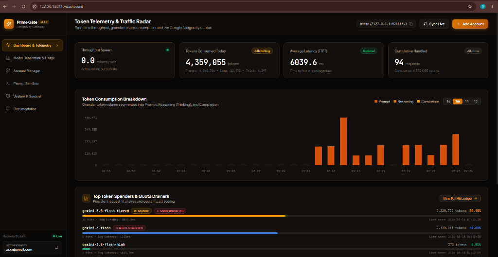
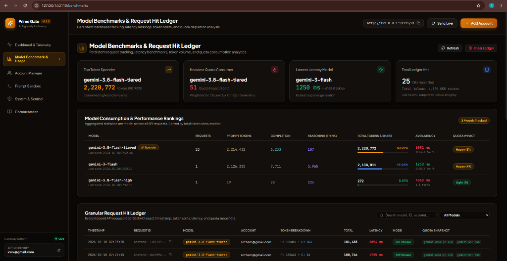
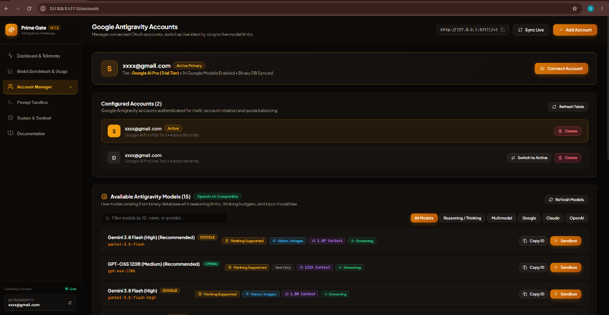
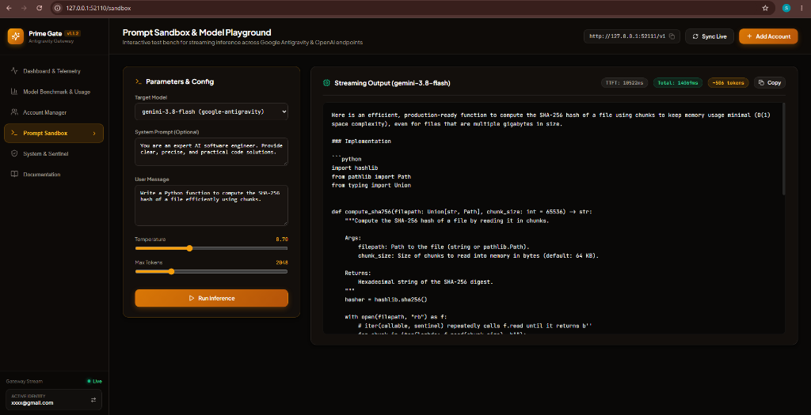
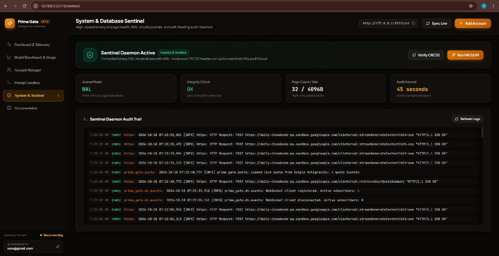

<div align="center">

# ⚡ Prime Gate Antigravity プロキシ
### `prime-gate-proxy-antigravity-lik`

**Google Antigravity向け本番グレード・セルフホスト型 OpenAI & Anthropic デュアルプロトコル互換プロキシゲートウェイ。**

[](https://github.com/irhamkaraman/prime-gate-proxy-antigravity-lik)
[](https://python.org)
[](https://nodejs.org)
[](../../LICENSE)

---

### 🌐 言語を選択 / Select Language

[🇺🇸 English](../../README.md) • [🇮🇩 Bahasa Indonesia](../id/README.md) • [🇨🇳 简体中文](../zh/README.md) • [🇷🇺 Русский](../ru/README.md) • [🇯🇵 日本語](README.md) • [🇩🇪 Deutsch](../de/README.md) • [🇫🇷 Français](../fr/README.md)

---

</div>

## 📖 概要

**Prime Gate** は、Google の内部 Cloud AI Companion / Antigravity API を **OpenAI 互換**（`/v1/chat/completions`）および **ネイティブ Anthropic Messages API 互換**（`/v1/messages`）の REST & SSE エンドポイントとしてラップするエンタープライズグレードのプロキシゲートウェイです。

**Claude Sonnet 4.6 (Thinking)**、**Claude Opus 4.6 (Thinking)**、**Gemini 3.8 Flash** などの強力なモデルを、**Claude Code CLI**、**Cline**、**Roo Code**、**OpenCode**、**Cursor**、**Continue.dev**、**Aider**、**SillyTavern** などのお好みの開発環境で直接利用できます。

---

## 🌟 主な機能

1. **OpenAI & Anthropic デュアルプロトコル対応:**
   OpenAI とネイティブ Anthropic (`/v1/messages`) の両プロトコルに対応し、Claude Code CLI に完全適合。
2. **多言語対応セマンティックベクトルキャッシュ (Semantic Cache):**
   FastEmbed ONNX ベクトル検索と SQLite WAL による高速応答（~12ms TTFT）。
3. **エンタープライズセキュリティ (AES-256-GCM):**
   OS Keyring による認証情報暗号化、API キーごとのレートリミット（RPM / TPD）およびキャッシュスコープ分離。
4. **リアルタイム思考プロセス（Thinking Mode）ストリーミング:**
   Claude 4.6 および Gemini 3.8 の深い推論プロセスを `choices[0].delta.reasoning_content` 経由でリアルタイム配信。
3. **400 Bad Request エラー防止（再帰的スキーマサニタイザー）:**
   Google Antigravity でサポートされていない JSON 制約（`exclusiveMinimum`、`$schema` 等）を自動除去し、ツール呼び出しを安定動作させます。
4. **アカウントクォータ＆プラン自動判定:**
   **`Google AI Pro (Trial Tier)`** と **`Paid Tier`** を自動判別し、利用可能なモデルのみを動的に提示します。
5. **最新 React 18 + TypeScript SPA ダッシュボード:**
   Vite ベースの高速 SPA（`/dashboard`、`/benchmarks`、`/accounts`、`/sandbox`、`/sentinel`）を採用。リアルタイムトークン推移グラフ、アカウント別クォータ管理、インタラクティブなテスト環境を完備。
6. **高機能 CLI スイート:**
   `quota`（クォータ一覧表示）、`auth`（アカウント管理・OAuth ログイン）、Windows 向けバックグラウンドデーモン管理に対応。

---

## 📸 ユーザーインターフェース＆デモ

React 18、TypeScript、WebSocket を採用したグラスモーフィズムデザインの Web 管理画面：

### 1. ダッシュボード＆リアルタイムテレメトリ (`/dashboard`)
トークン生成速度（tok/s）、過去24時間の累積トークン量、平均レスポンス遅延（TTFT）、時間帯別トークン消費グラフ（`1m`、`1h`、`1d`、`1month`）、消費量上位モデルのリーダーボードをリアルタイム表示。


### 2. 利用状況とモデルベンチマーク (`/benchmarks`)
SQLite WAL モードによるリアルタイム永続リクエスト台帳。モデル別の消費統計、遅延ベンチマーク、トークン比率、加重クォータ影響スコア（Claude 3x, GPT 2x, Gemini 1x）を可視化し、検索・フィルタリングに対応。


### 3. アカウント管理＆動的モデルカタログ (`/accounts`)
複数 Google OAuth アカウントの集中管理とアクティブ切り替え、クォータ残量メーター、機能バッジ付きモデルカタログ（Thinking 対応、画像/マルチモーダル、コンテキスト長、ストリーミング）。


### 4. プロンプトサンドボックス (`/sandbox`)
ストリーミング推論を直接テストできる対話型サンドボックス。システムプロンプト、温度、最大トークンを設定し、TTFT や生成速度（tok/s）をリアルタイム計測。


### 5. システム＆データベースセンチネル (`/sentinel`)
バイナリ SQLite WAL ストレージの健全性監査。CRC32 チェックサム検証、ページキャッシュ使用率、VACUUM 最適化、WebSocket 経由のリアルタイム監査ログ表示に対応。


---

## ⚡ クイックスタート

```bash
# NPX による即時起動（Git クローン不要）
npx prime-gate-antigravity daemon start

# クォータ確認
npx prime-gate-antigravity quota

# または NPM でグローバルインストール
npm install -g prime-gate-antigravity
prime-gate daemon start
```

### Web UI オンボーディング
1. ブラウザで **`http://127.0.0.1:52110`** を開きます。
2. アカウント未設定の場合、セットアップ画面が表示されます：
   - **"Sign in with Google"** をクリックして OAuth 2.0 PKCE でログイン。
   - または **"⚡ Quick Import from OpenCode Config"** をクリックして既存設定をインポート。
3. 認証完了後、自動的にメインダッシュボードへ遷移し、リアルタイムクォータと OpenAI エンドポイント (`http://127.0.0.1:52111/v1`) が利用可能になります。

> 💡 **ターミナル操作:** `python -m prime_gate.cli auth login` または `python -m prime_gate.cli quota` もご利用いただけます。

---

## 📜 ライセンス＆開発者

- **開発者:** [Irham Karaman](https://github.com/irhamkaraman)
- **ライセンス:** [MIT License](../../LICENSE)
